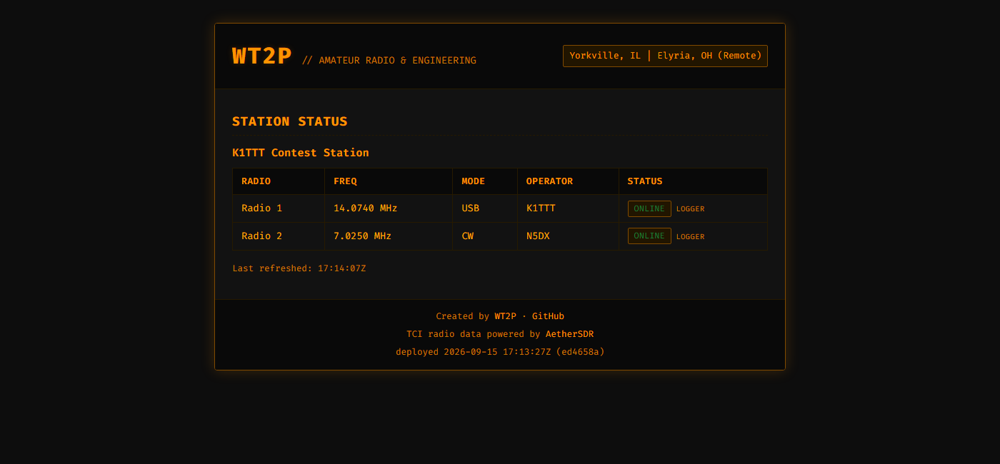
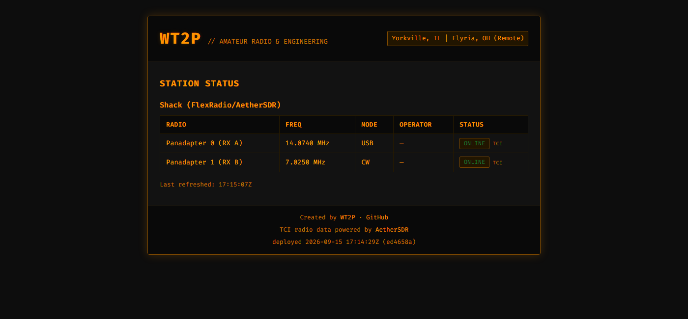

# Station Status Page

A near-real-time station status page (K1TTT-style) built from:

- **`server/`** — one small persistent process on your VPS (Python/FastAPI).
  Agents POST status to it; the browser polls it; it serves the frontend.
- **`agent/`** — runs on each shack computer, **the one that connects
  outbound to your VPS** — nothing on the shack LAN is ever reached
  directly by the VPS. Written in Go and compiled to a single standalone
  binary — no Python, no runtime — for Windows and for Linux on both
  x86-64 and ARM (an ARM Chromebook's Linux/Crostini container included).
  Build the binaries with the commands in Setup, or publish them via a
  Release; source is the `.go` files if you ever need to rebuild.
  One agent process runs in exactly one mode, chosen via `"source"` in
  its config.json or the `--source` flag: `tci`, `n1mm`, or `dxlog`.
- **`server/webtest/`** — tests for that page: jsdom loads it through
  its own `<script src>` tag and checks what a visitor ends up seeing
  (the status labels, the blanked cells, the TX chip's rules, the
  contest padlock, shack-LAN data rendering as text). `npm test` from
  the repo root; `npm ci` first. jsdom is the only Node dependency and
  it's dev-only — nothing Node ships to the VPS.
- **`server/static/`** — the page itself, in three files (split out of a
  single 589-line `index.html` on 2026-10-15): `index.html` is the
  markup, `style.css` the look (dark amber + Fira Code, matching
  wt2p.us), and `app.js` the behaviour — it polls `/api/status` every 3s
  and renders a table per station, plus (optionally) each station's last
  logged QSO — see *Last station worked*. **Every word the page shows a
  visitor is declared at the top of `app.js`**, so changing one is a
  one-line edit in a known place.

Everything has been **run and tested** in a sandbox — including the
actual compiled Go binaries talking to the actual Python server, and real
UDP packets for the N1MM path. See "What's been tested" at the bottom for
specifics on what's verified vs. what still needs checking on your
hardware.

## Screenshots

The page, running against the real server and the real compiled agent
binary — one station in N1MM mode, one in TCI (AetherSDR) mode:

**N1MM mode** — a real UDP `<RadioInfo>` broadcast → the agent → the server:



**TCI mode** — AetherSDR's `vfo:`/`modulation:` WebSocket stream → the agent → the server:



## Why this design

- **Expandable**: a "station" is just a JSON object with an id, a name,
  and a list of radios. Adding a second computer/station later means
  running another agent with its own config — the server and frontend
  don't need code changes.
- **Offline detection has two layers**: the agent reports on a heartbeat
  (default every 5s) regardless of whether anything changed, and each
  report includes `connected: true/false`. If AetherSDR/N1MM isn't
  running, the agent reports `connected: false` and the radio goes
  Offline immediately. If the whole agent process dies, no reports arrive
  at all, and the server's staleness timeout (default 20s) catches that.
- **Add-ons are not sources**: "last station worked" (an ADIF record per
  QSO from the logger) runs alongside whichever source an agent is in,
  with its own UDP port and its own goroutine, and contributes one
  station-level field to the report. It never decides whether a radio is
  online, so the live state the page exists for can't be affected by it.
- **One source per agent process, chosen explicitly**: `config.go`
  requires a valid `"source"` (or `--source` flag) and refuses to start
  otherwise — no silent fallback, no guessing. N1MM/DXLog run on the shack
  LAN and get translated into the same authenticated HTTPS push the TCI
  path already uses; the VPS never talks UDP or trusts unauthenticated
  broadcast traffic directly.

## Setup

### Server (on your VPS)

```bash
cd server
python3 -m venv venv
./venv/bin/pip install fastapi uvicorn
STATUS_API_TOKEN=<pick-a-real-secret> STATUS_OFFLINE_THRESHOLD=20 ./venv/bin/python3 server.py
```

See `deploy/DEPLOY.md` for the full systemd + nginx + Cloudflare Tunnel
runbook.

Env vars:
- `STATUS_API_TOKEN` — shared secret agents must send. Change the default.
- `STATUS_OFFLINE_THRESHOLD` — seconds of silence before a station/radio
  is marked Offline. A few multiples of the agent's report interval
  (default 5s), so 15–20 is reasonable.
- `STATUS_HOST` / `STATUS_PORT` — default `0.0.0.0:8000`.

### Agent (on each shack computer, Windows or Linux — x86-64 or ARM)

Nothing to install — copy the binary for your OS/arch and a config file, then run it.

**TCI mode** (AetherSDR panadapters), using `config.example.tci.json`:
```
stationagent-windows-amd64.exe config.json
```
or with the flag instead of a `"source"` field in the file:
```
stationagent-windows-amd64.exe --source tci config.json
```

**N1MM mode**, using `config.example.n1mm.json`:
```
stationagent-windows-amd64.exe --source n1mm config.json
```

**DXLog mode** (configured for N1MM-compatible broadcast — see the DXLog
section below), using `config.example.dxlog.json`:
```
stationagent-windows-amd64.exe --source dxlog config.json
```

Pre-built binaries live in `agent/build/` (not committed). All the Linux
builds are fully static (no shared library dependencies, no libc version
to match).

**Where to get them:** the `agent-build` GitHub Actions workflow
(`.github/workflows/agent-build.yml`) builds all four targets — Windows
x86-64, Linux x86-64, Linux ARM64, Linux ARMv7 — on every branch push,
after `go vet` / `go test` pass. Each run attaches the binaries as
downloadable artifacts. Every merge to `main` additionally refreshes the
rolling **`agent-latest`** pre-release with the four binaries attached, so
"grab the current main build" is a one-click download from the Releases
page. Or build them yourself with the commands below.

**Versions:** the repo-root `VERSION` file (a date, matching the release
tag) is the one version for both halves. CI stamps it plus the commit into
the agent binary — `stationagent -version` prints it, e.g.
`stationagent 2026.10.11+abc1234`, and so does the agent's startup log
line — and the server shows the same `VERSION` in the status page footer
(and at `/api/version`). Bump `VERSION` in the commit you tag for a
release. A local `go build` reports `dev`.

**ARM Linux / Chromebook:** the agent is pure Go with no cgo, so it
cross-compiles to ARM with nothing more than a different `GOARCH`. On a
Chromebook this means running it inside the Linux (Crostini) container:
`stationagent-linux-arm64` for a modern ARM Chromebook (MediaTek Kompanio
/ Qualcomm 7c — the Crostini userland is 64-bit), `stationagent-linux-armv7`
for an older 32-bit one. Run it exactly like the amd64 Linux binary.

If you ever need to rebuild from source (e.g. after changing `agent/*.go`),
you need the Go toolchain on *some* machine — not necessarily the shack
computer:
```bash
cd agent
GOOS=windows GOARCH=amd64                 go build -o build/stationagent-windows-amd64.exe .
CGO_ENABLED=0 GOOS=linux GOARCH=amd64     go build -o build/stationagent-linux-amd64 .
CGO_ENABLED=0 GOOS=linux GOARCH=arm64     go build -o build/stationagent-linux-arm64 .
CGO_ENABLED=0 GOOS=linux GOARCH=arm GOARM=7 go build -o build/stationagent-linux-armv7 .
```

## TCI format — confirmed against a real capture

Verified against an actual websocat capture of AetherSDR's TCI output
(not just docs), including forcing a mode change to see it broadcast live:

```
vfo:<receiver>,<vfo_index>,<frequency_hz>;   -- the operating frequency, in Hz
modulation:<receiver>,<mode>;                -- mode, sent LOWERCASE
                                                 ("usb", "cw") on connect
                                                 and on every change
trx:<receiver>,<true|false>[,<src>];         -- transmit on/off, per slice
                                                 (NOT yet confirmed against
                                                 a capture off your machine
                                                 -- see "Is it transmitting?")
```

`tci.go` normalizes mode to uppercase for consistent display, and handles
a real stray-comma artifact seen in the capture
(`rx_smeter:0,-91;,modulation:0,cw;`) — regression-tested in
`TestRealAetherSDRCapture` (`tci_test.go`) against the literal captured
data, artifact included.

Also present in real traffic, intentionally ignored: `dds:` (hardware/LO
tuning point — confirmed via the capture that it can sit fixed while
`vfo:` moves within the passband; `vfo:` is the one that tracks the
actual operating frequency), plus `rx_smeter:`, `rx_filter_band:`,
`active_slice:`, `sql_enable:`, and others.

**Confirmed:** receiver index maps directly to panadapter/RX number —
receiver 0 = Panadapter 0 = RX A, receiver 1 = Panadapter 1 = RX B, and so
on. `config.example.tci.json` uses this naming. Most of the time
(single-RX) you'll only need `panadapter0`; add more entries for SO2R and
beyond.

Still just a placeholder: the `40001` port in `config.example.tci.json`.
Check AetherSDR's own TCI panel for the real port. `tci_host`/`tci_port`
are required fields (`config_test.go`: `TestLoadConfigTCIMissingPort`,
`TestLoadConfigTCIMissingHost`) — an unset port fails immediately at
startup with a clear message, rather than silently retrying a connection
to port 0 forever. Same reasoning as the required `n1mm_port`/
`dxlog_port`: none of these three have a port worth hardcoding as a
default, since real setups (including yours) sometimes deviate from
common defaults.

Re-verify or capture more with `websocat ws://localhost:<your-tci-port>`
(single binary, no install) if anything changes.

## Is it transmitting? — the `[TX]` chip (added 2026-10-11)

When a slice is keyed, a small red **`[TX]`** chip appears next to that
radio's name on the status page, and disappears when it unkeys. That's the
whole feature; it's the fastest thing on the page to read, which is the
point — it answers "can I key up on that radio?" without parsing a table.

**TCI only, by design.** TCI is a direct link to the radio and states
transmit explicitly (`trx:`). N1MM's and DXLog's `<RadioInfo>` broadcast
describes *where a radio is tuned*, not whether it's keyed — so those
agents always report `tx: false` rather than inferring something. The
frontend additionally gates the chip on `source === "tci"`, so a future
source that can't really tell can't light it up by sending a hopeful
`true`.

**It is not masked by contest mode.** What contest mode protects is the
exact frequency you're running on; "this radio is keyed right now" gives
away nothing about where, and is the most useful thing on the page while
it's true. If you ever want it hidden too, that's a one-line change in
`tciRadiosSnapshot`.

**Three ways it can't get stuck on.** TCI only tells you a transmission
ended by sending `trx:<rx>,false`, so every path that loses the stream has
to clear it explicitly:

1. **The WebSocket drops** → `setConnected(false)` zeroes every receiver's
   TX (`TestDisconnectClearsTransmitState`). Frequency is deliberately
   *not* cleared — that's still the last place the radio was.
2. **The agent dies, or the network goes** → the server gates `tx` on the
   same staleness check as `freq_hz`, so it reads false the moment the
   radio reads offline.
3. **A `trx:` value we can't parse** → previous state is left alone rather
   than defaulting to false. This is the one asymmetry on purpose: dropping
   a chip mid-transmission misleads an operator, where briefly keeping one
   doesn't.

**Verifying the command name on your hardware.** Unlike `vfo:` and
`modulation:`, `trx:` has *not* been seen in a capture off your machine —
it's the TCI spec's name and what every other TCI implementation uses, but
AetherSDR hasn't been confirmed to send it. Check with:

```
websocat ws://localhost:<your-tci-port> | grep -i -e trx -e tx_
```

then key each slice. If `trx:0,true;` shows up, it already works. If
something *else* appears instead (e.g. `tx_enable:`), that command name
goes in the `case "trx":` arm of `tci.go`'s `apply()` and nothing else
changes.

The failure mode if the name is wrong is benign and silent: an unknown TCI
command is a no-op, so the chip simply never appears and the rest of the
page behaves exactly as before. Nothing breaks, you just don't get the
chip until the name is corrected.

**Accessibility:** the chip carries `aria-label="Transmitting"` and
`role="status"`, and its pulse is dropped under
`prefers-reduced-motion: reduce` — the colour and border already carry the
whole message.

## N1MM format — confirmed against official docs

Verified against N1MM Logger+'s official UDP broadcast documentation
(https://n1mmwp.hamdocs.com/appendices/external-udp-broadcasts/), which
includes a literal example `<RadioInfo>` packet — not inferred from a
description, the actual XML. `n1mm.go`'s header comment has the full
example and reasoning. Key points, including one genuine gotcha:

- Default port is **12060** — confirm against N1MM's own Broadcast Data
  tab, don't assume it wasn't changed.
- **`Freq`/`TXFreq` are in tens of Hz, not Hz.** The official example
  (`<Freq>352211</Freq>` labeled `<StationName>CW-80m</StationName>`)
  only checks out as 3.52211 MHz once multiplied by 10. `n1mm.go` does
  this multiplication; `TestN1MMOfficialExamplePacket` in `n1mm_test.go`
  regression-tests it against that literal example so it can't silently
  drift back to raw Hz.
- `RadioNr` is **1-based** (1 or 2) — deliberately not renumbered to
  0-based like TCI's receivers, so `config.example.n1mm.json` uses
  `n1mm_radio_nr: 1` / `2` directly, matching what you'd see in N1MM
  itself.
- `OpCall` is the operator; per the docs it defaults to the station's own
  callsign (`mycall`) when nobody has explicitly logged in via OPON.
  `n1mm.go` implements that same fallback chain — OpCall, then mycall,
  then the `default_operator` you set in config.json — as defense in
  depth, not as a guess about undocumented behavior.
- N1MM broadcasts several other packet types (ContactInfo, Spot, Score,
  etc.) on the same port if you enable them. Only `<RadioInfo>` is parsed;
  everything else fails to unmarshal (root element name won't match) and
  is silently ignored — confirmed intentional and tested
  (`TestN1MMIgnoresNonRadioInfoPackets`), not an oversight.
- Unlike TCI's live WebSocket, UDP broadcast has no "connection" to
  track — `n1mm.go` calls a radio Offline if no packet arrived in the
  last 25s (N1MM's own heartbeat is ~10s, so this allows a couple of
  missed beats before giving up).

This is real published spec, cross-referenced by several independent
third-party N1MM tools — solid enough to build against directly. Still,
if your actual N1MM output looks different from what's documented here
(version differences do happen), the fix is the same as it always is:
capture a real packet and tell me what's different, rather than assume
the doc is stale and patch around a guess.

## DXLog — reuses the N1MM parser, with one caveat

You mentioned you'll configure DXLog in its N1MM-compatible broadcast
mode (Options|Broadcast|Radio information, "N1MM-like format") —
something you'd specifically requested years ago for Node-RED dashboard
compatibility. Since that mode's whole purpose is to reproduce N1MM's own
`<RadioInfo>` schema, `dxlog.go`... doesn't exist. `source: "dxlog"`
reuses `n1mm.go`'s parser directly (`N1MMSource`), because it's the same
wire format, not a coincidentally-similar one.

What's different from plain N1MM mode, both confirmed via DXLog's own
docs:
- **Default port is 13063**, not N1MM's 12060 — a separate documented
  default, set via `dxlog_port` in `config.example.dxlog.json`.
- The status field in reports correctly says `"dxlog"`, not `"n1mm"`, so
  the origin is still visible on the status page even though the parser
  is shared.

**The one real caveat:** the "these two formats are identical" premise
rests on your recollection of requesting that compatibility mode years
ago, not a fresh capture of what DXLog actually sends today. That's
decent evidence, not nothing — but once you've got DXLog actually running
in this mode, a quick capture to confirm is worth doing, the same
discipline as everything else here. If it turns out to differ in some
field, that's a small patch to `n1mm.go`, not a rewrite, since it's
already structured to ignore anything it doesn't recognize rather than
crash on it.

Tested (in the same sandbox sense as everything else): a real UDP packet
sent to port 13063 (DXLog's documented port, not N1MM's), through the
actual compiled `dxlog`-mode binary, correctly reporting 14.0805 MHz,
USB, operator falling back to `mycall` when `OpCall` was empty — and the
log line correctly reads `[dxlog :13063]`, not `[n1mm :13063]`.

## Contest mode — the exact frequency never leaves the shack LAN

Set `"contest_mode": true` at the top level of the agent's config.json
(sibling of `"source"` — it's a whole-agent-process setting, not
per-radio, exactly like `"source"`). Default is `false`; omitting the key
entirely is the same as `false`.

**What it does:** the agent still reads the real operating frequency from
TCI / N1MM / DXLog internally, but it converts it to a US amateur *band
name* ("40M", "20M", …) and sends only that. The outbound report has
`band` set and `freq_hz` explicitly `null`. The server stores and serves
whatever it's given; the frontend shows the band string in the Freq
column when present, and the normal `14.0740 MHz` formatting otherwise.

**The privacy guarantee:** the exact VFO frequency is never transmitted
off the shack LAN and never reaches the server, the `/api/status` JSON,
or the browser. This is enforced agent-side, before the HTTPS push — not
as a UI filter over data that's still sitting in the public API response.
`mode` and `operator` are unaffected; contest mode only touches
frequency/band. All three sources (`tci`, `n1mm`, `dxlog`) inherit the
behavior automatically since they share the same report-building path.

**Band edges** are hardcoded in `agent/band.go` and were checked against
ARRL's published US allocations, not a remembered table:
- ARRL Frequency Allocations chart
  (https://www.arrl.org/frequency-allocations) and ARRL Band Plan
  (https://www.arrl.org/band-plan), cross-checked against each other, for
  160M through 23CM plus the 2200M / 630M LF/MF bands.
- 60M is not a contiguous allocation. Per the FCC rules effective
  2026-02-13 (ARRL: "New 60-Meter Frequencies Available as of February
  13", https://www.arrl.org/news/new-60-meter-frequencies-available-as-of-february-13),
  US amateurs have four 2.8 kHz channels centered on 5332 / 5348 / 5373 /
  5405 kHz plus a contiguous 5351.5–5366.5 kHz segment. `band.go`
  classifies the whole 5330.6–5406.4 kHz envelope (lowest channel edge to
  highest channel edge) as "60M" — finer resolution than the band name
  is exactly what contest mode is meant to withhold.
- A frequency in no recognized band returns the sentinel `"OOB"` (out of
  band), never an empty string or a panic.

`band.go`'s header comment carries the full table and reasoning;
`band_test.go` covers a real operating frequency in every band, inclusive
band-edge cases, and out-of-band inputs (including 0 and negative).
`contest_mode_test.go` proves the actual privacy property end to end
through the real snapshot code path: with `contest_mode` on a report's
`FreqHz` is `nil` and `Band` is populated; with it off (or unset),
behavior is byte-for-byte unchanged (`Band` nil, `FreqHz` sent as
normal).

## Last station worked — an ADIF record per QSO (added 2026-10-11)

The page can show the last QSO the logger put on the air, under that
station's radios: **date, time (UTC), callsign, band and mode**, with a
`QRZero Logged` chip.

Set it up in the agent's config.json (sibling of `"source"`, a
whole-agent-process setting like `contest_mode`):

```json
"last_worked": true,
"adif_port": 14060
```

`adif_port` alone is enough — it switches the feature on. `last_worked`
alone is enough too; the port then defaults to **14060**. Omit both and
nothing changes.

Then, in the logger, point a UDP connection at the agent's machine on that
port. In **QRZero** (https://github.com/nreed97/QRZero) that's
**Settings → UDP connections**: *Sends when* = **QSO logged**, *Format* =
**ADIF record**, host = the agent's computer (`127.0.0.1` if it's the same
one), port = `14060`. Its **Send test** button fires a sample record
straight away, which is the quickest way to see the line appear.

**Why 14060:** it is nowhere near N1MM's 12060 / 12061 / 12062 or DXLog's
13063, so pointing a logger here can never collide with a radio-state
broadcast — including the one this very agent may be listening to in
`n1mm` mode. Two UDP sockets on one port inside one process don't error on
Linux, they just split the traffic unpredictably, so the agent **refuses
to start** if `adif_port` equals the configured `n1mm_port` or
`dxlog_port`, rather than letting you debug that later.

**It runs in the agent, not the server.** `agent/adif.go` does the
listening and the parsing on the shack computer; what leaves the LAN is
the same authenticated HTTPS report the agent already sends, with one
extra `last_worked` object. The server has no ADIF endpoint and no UDP
port — the same rule the N1MM path follows — it only holds the last one
reported and hands it to the page.

**The frequency is masked to a band, always.** A logged QSO's exact
frequency never leaves the shack LAN, whether or not `contest_mode` is on:
the agent reads the record's `FREQ`, hands it to `band.go`'s `freqToBand`
— the same function and the same ARRL-checked table contest mode uses —
and reports only the band *name*. So a QSO reads `20M`, exactly like a
masked radio row, and nothing finer exists in the API response or the
browser. ADIF's own `BAND` field ("20m", lower case) is the fallback for a
record with no `FREQ`; `freqToBand` is preferred so the label matches the
rest of the page rather than whatever spelling the logger chose. A
frequency in no amateur band reads `OOB`, band.go's sentinel, not a guess.

**Nothing else is sent.** An ADIF record carries everything the logger
knows about a QSO: reports, grid, name, QTH, comment. None of it is read,
and none of it leaves the shack LAN. `adif_test.go` asserts both halves
against a real QRZero-shaped record — the fields that must be there, and
the frequency, reports, name and comment that must not — so widening the
payload means changing that test on purpose.

**Wire format**, taken from QRZero's own source (`crates/server/src/
udp_out.rs`'s `Format::Adif` → `crates/core/src/adif.rs`'s `write_record`)
rather than assumed, and from its user docs (*UDP connections and startup
programs*):

```
<CALL:6>DL1ABC <QSO_DATE:8>20261011 <TIME_ON:6>011530 <BAND:3>20m <FREQ:7>14.0255 <MODE:2>CW <RST_SENT:3>599 <RST_RCVD:3>579 <EOR>
```

One datagram, one bare record — no ADIF header, no `<EOH>`. Details that
matter and were checked, not guessed:
- the **length in each tag** decides where a value ends, so a `COMMENT` or
  `NAME` containing spaces doesn't derail the parse;
- a digital QSO's real mode is in **`SUBMODE`** (ADIF stores FT4 as
  `MODE=MFSK` + `SUBMODE=FT4`), so `SUBMODE` wins — otherwise an FT4 QSO
  would read "MFSK";
- `QSO_DATE`/`TIME_ON` are **UTC**, and `TIME_ON` may be `HHMMSS` or
  `HHMM`. A record with no usable time falls back to when it arrived.

**The chip says which port, not which program.** Nothing in an ADIF record
identifies the sender, so `QRZero Logged` means "came in on the agent's
ADIF connection" — which is what QRZero's *QSO logged* connection is.
Any logger that can send an ADIF record to a UDP port works the same way.

**It doesn't expire and it doesn't affect online/offline.** A QSO is an
event, not a heartbeat: hours of silence between contests is normal, so
there is no timeout after which "no records" means anything. The line
keeps showing the last QSO with its own timestamp — including while the
station is offline, unlike the radio rows, which blank because a
frequency is a claim about *right now* while a logged QSO is a dated fact.

## 404s, and what the API answers (added 2026-10-11)

Two things a public hostname shouldn't do, both fixed in `server.py`:

- **An unknown page used to return `{"detail":"Not Found"}`.** Visiting
  `remote.wt2p.us/foo` in a browser got a JSON blob, which is both useless
  to a person and an advertisement that there's an API here. Unknown paths
  now get `server/static/404.html` -- the site's own chrome, amber on
  near-black, with links back to the status page -- with a real 404 status
  so monitors and crawlers aren't misled.
- **FastAPI's `/docs`, `/redoc` and `/openapi.json` were live**, handing
  any visitor a browsable map of every route including `POST /api/report`,
  the authenticated ingest. They're switched off
  (`FastAPI(docs_url=None, redoc_url=None, openapi_url=None)`) -- the only
  clients are the agent and this project's own page, and the routes are
  documented here. Those three paths now get the 404 page like any other
  unknown URL.

**An unknown `/api/...` path still answers JSON** (`{"detail": "not
found"}`, 404): an HTML page would be useless to the agent or to curl. The
split is purely on the path prefix, so adding an API route never changes
which kind of 404 it produces. Every non-404 status -- 401 for a bad
token, 400 for a report with no `station_id` -- keeps FastAPI's normal
JSON shape unchanged, since those are only ever seen by the agent.

One subtlety worth knowing before touching this: the `StaticFiles` mount
at `/` is greedy *and*, with `html=True`, answers its own 404s by serving
`404.html` itself. So the unknown-`/api/...` case needs **real routes**
(`/api`, `/api/`, `/api/{rest:path}`, declared after every real one), not
just an exception handler -- otherwise the mount wins and `curl
/api/typo` gets a page of HTML.

## What's been tested (in a sandbox, not on your hardware)

- Go unit tests (`go test ./...` in `agent/`), including:
  - `TestRealAetherSDRCapture` — built from your actual captured TCI
    output (comma artifact included).
  - `TestN1MMOfficialExamplePacket` — built from N1MM's official example
    packet, confirming the tens-of-Hz math and OpCall parsing.
  - `TestN1MMOperatorFallsBackToMyCallThenDefault` — the OpCall → mycall
    → default_operator fallback chain.
  - `TestN1MMIgnoresNonRadioInfoPackets` — a ContactInfo-shaped packet on
    the same port doesn't get mistaken for radio state or crash anything.
  - `TestN1MMStaleAfterTimeout` — a radio with no recent packet reads as
    disconnected.
  - `config_test.go` — source validation for all three modes (missing
    tci_port/tci_host, missing dxlog_port, missing radio_nr, `--source`
    flag overriding a file with no `"source"` field, no source configured
    anywhere failing loudly).
  - Malformed-input cases for both sources that must not panic.
  - `band_test.go` — a real operating frequency in every band 2200M–23CM
    maps to the right name, inclusive band edges classify correctly, and
    out-of-band inputs (including 0 and a negative) return `"OOB"` without
    panicking. Band table is also asserted to be ascending and
    non-overlapping.
  - `adif_test.go` — the last-worked path: a real QRZero-shaped record
    parses to the right call/mode/band/UTC timestamp; the frequency mask
    (14.0255 MHz → `20M` via band.go, ADIF's own `BAND` only as a
    fallback, `OOB` for a frequency in no band, no band at all rather than
    a guess when a record has neither, and the MHz→Hz rounding); a value
    with spaces
    (`COMMENT`, `NAME`) survives because the declared length is honoured;
    `SUBMODE` beats `MODE` so FT4 isn't "MFSK"; `TIME_ON` as `HHMM`, a
    garbage `TIME_ON`, and a record with no time at all all behave; a
    record with no `CALL` is dropped; several records in one datagram keep
    the last; an N1MM `<RadioInfo>` packet, a bad length, an unterminated
    tag and plain junk are ignored *without* overwriting a good QSO; an
    ADIF file's header doesn't leak into the first record; lower-case
    field names work; the port rules (default 14060, a port alone enabling
    the feature, refusing a collision with `n1mm_port`/`dxlog_port`); and
    the payload is asserted to carry only date/time/call/mode — the test
    fails if `FREQ`, `BAND`, reports or a name ever leak into it.
  - The `[TX]` chip's transmit tracking (`tci_test.go`): `trx:` is
    tracked per receiver so keying slice 1 leaves slice 0 alone; the
    optional "what keyed it" third field (`trx:0,true,mic`) doesn't change
    the reading; an unparseable value leaves the previous state alone
    rather than defaulting to false; and `TestDisconnectClearsTransmitState`
    covers the stuck-chip guard — a dropped WebSocket clears TX while
    deliberately leaving the last known frequency in place.
  - `contest_mode_test.go` — the privacy property, through the real
    snapshot code path for both TCI and N1MM/DXLog: with `contest_mode`
    on, a report's `FreqHz` is `nil` and `Band` is set; with it off or
    unset, `Band` is `nil` and `FreqHz` is sent unchanged. Also confirms
    `mode`/`operator` are untouched by contest mode and that the config
    field parses with no special validation (omitted ⇒ false).
- 404 behavior, every path checked against a locally running server:
  `/foo` and `/deep/path/here` -> the styled page with a 404 status;
  `/docs`, `/redoc`, `/openapi.json` -> the same page, 404 (not FastAPI's
  explorer); `/api`, `/api/`, `/api/foo`, `GET /api/report` ->
  `{"detail":"not found"}` as JSON; `/`, `/index.html`, `/api/status`,
  `/api/health` -> unchanged 200s; and no regression on the error shapes
  the agent sees (401 `bad or missing token`, 400 `station_id required`,
  and a real report with a `last_worked` still round-tripping to
  `/api/status`).
- All binaries cross-compiled and confirmed by `file`: a real PE32+
  Windows binary, a static ELF64 x86-64 Linux binary, a static ELF64 ARM
  aarch64 binary (`stationagent-linux-arm64`, for ARM Chromebooks via
  Crostini), and a static ELF32 ARM EABI5 binary (`stationagent-linux-armv7`).
  The ARM builds are cross-compile + `file`-verified only — not yet run on
  actual ARM hardware.
- Full end-to-end run using the **actual compiled Linux binary**, twice:
  - TCI mode: a fake TCI WebSocket server → the agent binary → the real
    Python server → `/api/status` correctly Online with right freq/mode.
  - N1MM mode: a real UDP packet (the literal official example) sent over
    an actual socket → the agent binary's UDP listener → the real Python
    server → `/api/status` showing 3.52211 MHz, CW, operator W1ABC.
  - `--source` flag confirmed to override a config.json with no
    `"source"` field; missing source with no flag fails with a clear
    error instead of guessing a default.
  - Last station worked: the **actual compiled binary** in `n1mm` mode
    with `"last_worked": true`, a QRZero-shaped ADIF record sent to
    :14060 over a real socket → the agent → the real Python server →
    `/api/status` carrying
    `"last_worked":{"call":"DL1ABC","mode":"CW","band":"20M","at":"2026-10-11T01:15:30Z","source":"qrzero"}`
    — the record's own `<FREQ:7>14.0255` nowhere in the response — and the
    page rendering `Last worked DL1ABC 20M CW QRZero Logged
    2026-10-11 01:15Z`. Not yet tested against QRZero itself — its
    **Send test** button is the first thing to try on your hardware.
  - DXLog mode: a real UDP packet sent to port 13063 (its documented
    port, distinct from N1MM's 12060) → the actual compiled `dxlog`-mode
    binary → the real server → `/api/status` showing 14.0805 MHz, USB,
    operator correctly falling back to `mycall`. Log line confirmed to
    read `[dxlog :13063]`, not `[n1mm :13063]`, despite sharing the parser.
  - Contest mode: a fake TCI source feeding 14.074 MHz → the **actual
    compiled Windows binary** with `"contest_mode": true` → the real
    Python server → `curl /api/status` showing `"band": "20M"` and
    `"freq_hz": null`, with the literal string `14074000` appearing
    nowhere in the response. The same binary with `"contest_mode": false`
    against the same source reported `"freq_hz": 14074000`, `"band":
    null` — unchanged from today. Confirmed the server's offline/staleness
    logic (which only looks at report timestamps and `connected`) doesn't
    choke on a null `freq_hz`.
  - The `[TX]` chip, end to end with the **actual compiled binary**: a
    fake TCI WebSocket server scripted to tune both slices, key slice 1,
    unkey it, then key slice 0 → the agent → the real Python server →
    `/api/status` polled throughout, showing `tx` flipping per slice
    independently and never on the wrong one. Then the stuck-chip guard
    for real: the TCI server was killed *while slice 0 was keyed*, and
    `tx` read `false` (with the radio `offline`) rather than latching on.
    The frontend's `txChip()` was exercised directly against its own
    source for all six cases — it emits the chip only for an online TCI
    radio that is keyed, and withholds it for a stale `tx: true` on an
    offline radio, for `n1mm`/`dxlog` reporting `tx: true`, and for an
    older agent build that sends no `tx` field at all.
- Server flow on its own: valid report → Online; bad auth token → 401;
  reports stop arriving → Offline past the threshold; multiple stations
  independently; `connected: false` → immediate Offline.
- Static frontend served correctly by the same process, and visually
  rendered in a headless browser against your real CSS/font/header.

Not tested: **whether AetherSDR actually names the transmit command
`trx:`** — it's the TCI spec's name and what other implementations use,
but it's the one command here not seen in a capture off your hardware, and
it's a one-line fix in `tci.go` if it's something else (see "Is it
transmitting?"). Also not tested: an actual AetherSDR or N1MM instance, running the agent on a
real Windows machine (only cross-compiled and confirmed as a valid
Windows executable), running the ARM builds on actual ARM hardware / a
Chromebook (cross-compiled and `file`-verified only), or the frontend in
a real (non-headless) browser.
